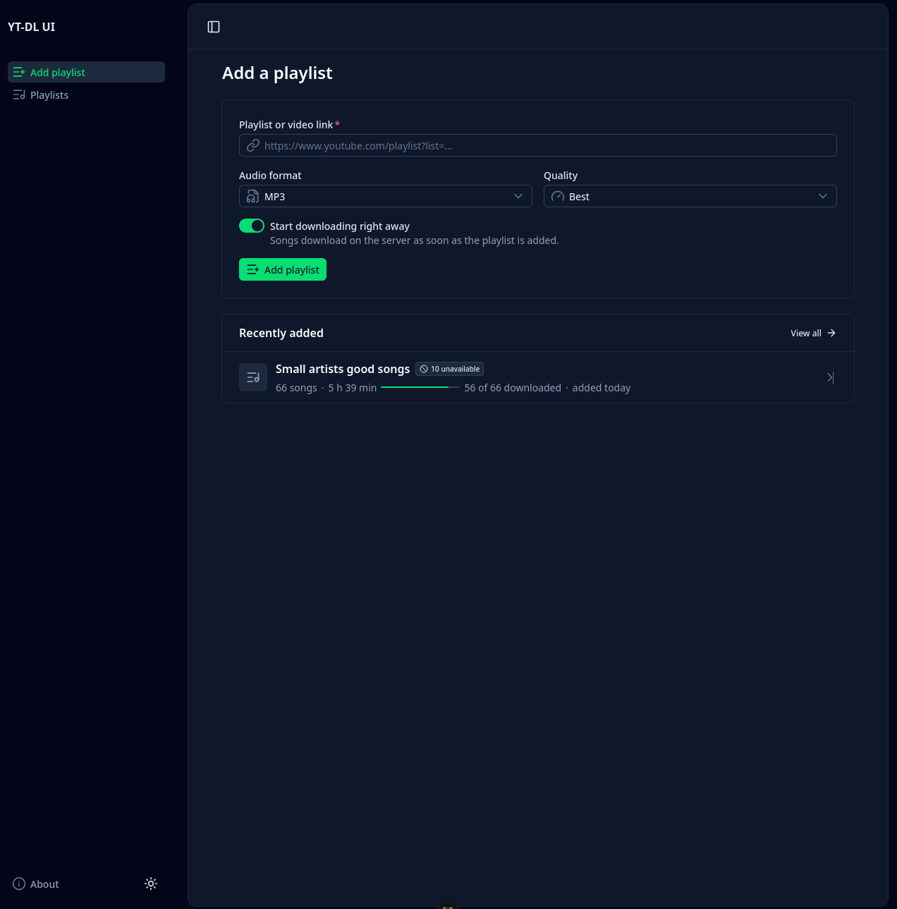
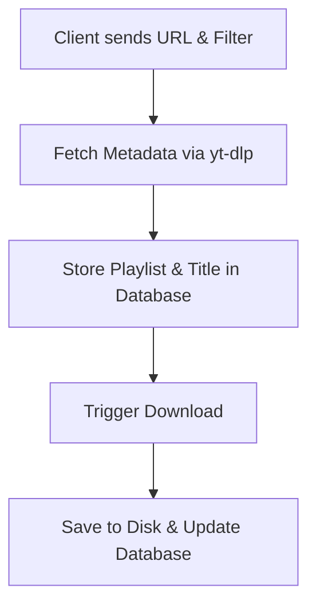

# YTDL Web

This project provides a web interface for the command-line tool: `yt-dlp`.

Please refer to the original [yt-dlp](https://github.com/yt-dlp/yt-dlp) repository for more information.



## Project Structure

The project is split into different subprojects:

- `yt-dlp-ui`: The UI using Vue and Nuxt UI.
- `yt-dlp-api`: The API written in Go.
- `yt-dlp-db`: Contains the database definition for the project.
- `yt-dlp-bruno`: Contains API calls for testing purposes.

## Getting Started (WIP)

We encourage you to use our Docker setup if you want to deploy the project to your own server. For development purposes, we also include instructions on how to run the different parts of the project in a standalone fashion.

### Docker Setup (Recommended)

We recommend running the project using Docker. Docker is the only thing the host needs: the images bring `yt-dlp`, `ffmpeg`, `deno` and the migrations with them.

The stack expects a [Traefik](https://traefik.io/) instance on the external Docker network `traefik-network`, with an entrypoint `websecure` and a certresolver `letsencrypt`. Adjust the labels in `docker-compose.yaml` if your setup uses other names.

| Service | What it does |
| --- | --- |
| `yt-dlp-db` | Postgres 18, on an internal network with no published ports and no internet access. |
| `yt-dlp-migrate` | An image with `yt-dlp-db/migrations` baked in. Applies pending migrations, then exits. |
| `yt-dlp-api` | The Go API, with `yt-dlp`, `ffmpeg` and `deno`. Downloads are kept in the `downloads` volume. |
| `yt-dlp-ui` | nginx. Serves the UI and proxies `/api` to the API. This is the only service Traefik routes to. |

Create the `.env` in the root of the repository and set `DB_USER`, `DB_PASSWORD`, `DB_NAME` and `APP_HOST`. Compose refuses to start without them.

```bash
cp .env.example .env
docker compose up -d --build
docker compose ps
```

Every `docker compose up` starts the database, waits until it is healthy, runs `yt-dlp-migrate`, and starts the API only once the migrations succeeded. The UI starts once the API's healthcheck (`GET /api/health`) passes. A fresh volume gets the full schema, an existing one only the new migrations. After a reboot, Docker restarts the database, API and UI but not the migrations. That's fine: new migrations only arrive with a new build, and that build runs `docker compose up` again.

All containers run with `no-new-privileges`. The migrations, API and UI have read-only root filesystems, and the API and migrations drop all capabilities. Logs rotate at 3 × 10 MB per container.

There is no login. Anyone who can reach `APP_HOST` can use the app, so add an auth middleware in Traefik if the host is public.

#### Updating yt-dlp

YouTube changes break `yt-dlp` regularly. The latest release is installed when the API image is built. To pick up a new one, rebuild without the cache:

```bash
docker compose build --pull --no-cache yt-dlp-api
docker compose up -d
```

Set `YTDLP_VERSION` in `.env` to pin a release instead.

#### Cookies

To use a YouTube account, export its cookies in Netscape format to `./cookies/cookies.txt`, uncomment the `./cookies` volume of `yt-dlp-api` and set `YT_COOKIES_FILE=/data/cookies/cookies.txt`. The file must be writable by uid 1000, because `yt-dlp` writes the cookie jar back. `YT_COOKIES_FROM_BROWSER` does not work inside the container.

### Database

We are using `golang-migrate` to manage migrations.

Creating a new migration:

```bash
migrate create -ext sql -dir yt-dlp-db/migrations -seq <migration_name>
``` 

Applying migrations to the database:

```bash
migrate -path yt-dlp-db/migrations -database "postgres://<user>:<pass>@<url>:<port>/<db>?sslmode=disable" up
``` 

### Backend

First you will need to update the `.env` file

```bash
cd yt-dlp-api
cp .env.example .env
```

Adjust the values according to your preferences.

Ensure you have `go` installed on your system.


```bash
cd yt-dlp-api
go run cmd/api/main.go
```

This will fetch dependencies and run the Backend.

### Frontend

First you will need to update the `.env` file

```bash
cd yt-dlp-ui
cp .env.example .env
```

You should have node and `pnpm` installed on your system `npm` will work too, personally I develop with pnpm

```bash
cd yt-dlp-ui
pnpm i # install dependencies
pnpm run dev # launch dev server
```

## General Workflow

1. **Client Request**: The client sends a URL and filter configuration.
2. **Metadata Fetching**: Metadata is fetched using `yt-dlp` (individual songs are treated as a playlist of length 1).
3. **Information Storage**: Playlist and title information is stored in the database.
4. **Download Execution**: Each video in the playlist is downloaded via `yt-dlp` and saved to a dedicated playlist folder on disk.
5. **Status Update**: Database entries are updated to reflect the file location and the download status.

### Workflow Diagram

