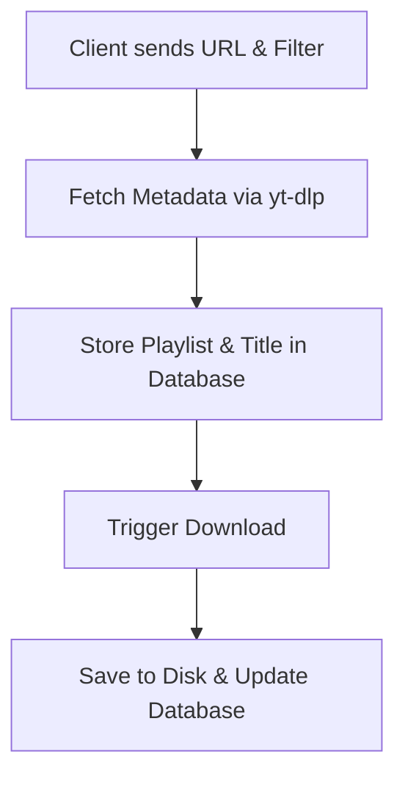

# YTDL Web

This project provides a web interface for the command line tool: `yt-dlp`

Please refer to the original [yt-dlp](https://github.com/yt-dlp/yt-dlp) repository for more information.

## Project Structure

The project is split into different subprojects:

- `ytdl-ui`: The main web interface for the `yt-dlp` command line tool
- `ytdl-api`: The API server for the `yt-dlp` command line tool
- `ytdl-db`: The database configuration for the `yt-dlp` command line tool

## General workflow

1. **Client Request**: The client sends a URL and filter configuration.
2. **Metadata Fetching**: Metadata is fetched using `yt-dlp` (individual songs are treated as a playlist of length 1).
3. **Information Storage**: Playlist and title information is stored in the database.
4. **Download Execution**: Each video in the playlist is downloaded via `yt-dlp` and saved to a dedicated playlist folder on disk.
5. **Status Update**: Database entries are updated to reflect the file location and the download status.

### Workflow Diagram

