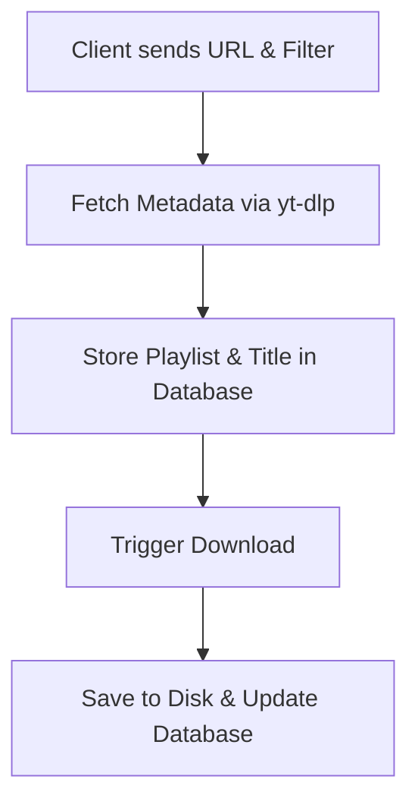

# YTDL Web

This project provides a web interface for the command-line tool: `yt-dlp`.

Please refer to the original [yt-dlp](https://github.com/yt-dlp/yt-dlp) repository for more information.

## Project Structure

The project is split into different subprojects:

- `yt-dlp-ui`: The UI using Vue and Nuxt UI.
- `yt-dlp-api`: The API written in Go.
- `yt-dlp-db`: Contains the database definition for the project.
- `yt-dlp-bruno`: Contains API calls for testing purposes.

## Getting Started (WIP)

We encourage you to use our Docker setup if you want to deploy the project to your own server. For development purposes, we also include instructions on how to run the different parts of the project in a standalone fashion.

### Docker Setup (Recommended)

We recommend running the project using Docker. A `docker-compose.yaml` file can be found in the root of the repository. Configure the application to your preferences by creating a `.env` file in the root of the repository. A sample configuration can be found in `.env.example`. 

Run the full stack using:

```bash
docker compose up -d
```

If you have your own Postgres DB already, you may want to remove the DB service. Or simply run the API and UI instead.

```bash
docker compose up -d yt-dlp-api yt-dlp-ui
``` 

### Database

We are using `golang-migrate` to manage migrations.

Creating a new migration:

```bash
migrate create -ext sql -dir yt-dlp-db/migrations -seq <migration_name>
``` 

Applying migrations to the database:

```bash
migrate -path yt-dlp-db/migrations -database "postgres://<user>:<pass>@<url>:<port>/<db>?sslmode=disable" up
``` 

### Backend

First you will need to update the `.env` file

```bash
cd yt-dlp-api
cp .env.example .env
```

Adjust the values according to your preferences.

Ensure you have `go` installed on your system.


```bash
cd yt-dlp-api
go run cmd/api/main.go
```

This will fetch dependencies and run the Backend.

### Frontend

First you will need to update the `.env` file

```bash
cd yt-dlp-ui
cp .env.example .env
```

You should have node and `pnpm` installed on your system `npm` will work too, personally I develop with pnpm

```bash
cd yt-dlp-ui
pnpm i # install dependencies
pnpm run dev # launch dev server
```

## General Workflow

1. **Client Request**: The client sends a URL and filter configuration.
2. **Metadata Fetching**: Metadata is fetched using `yt-dlp` (individual songs are treated as a playlist of length 1).
3. **Information Storage**: Playlist and title information is stored in the database.
4. **Download Execution**: Each video in the playlist is downloaded via `yt-dlp` and saved to a dedicated playlist folder on disk.
5. **Status Update**: Database entries are updated to reflect the file location and the download status.

### Workflow Diagram

